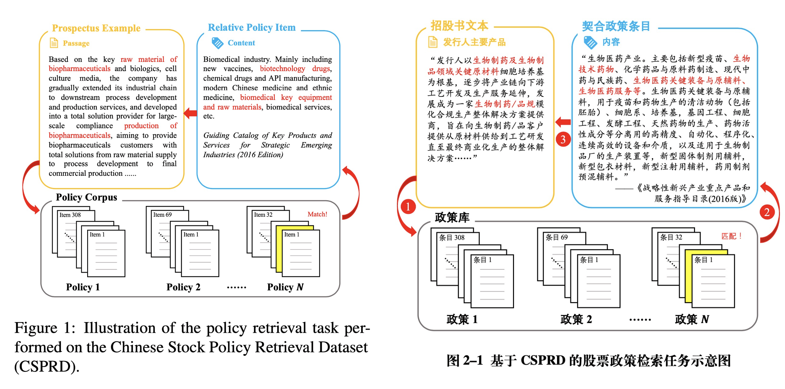
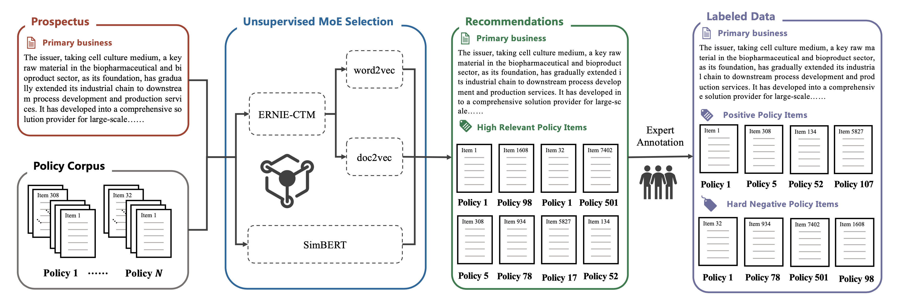
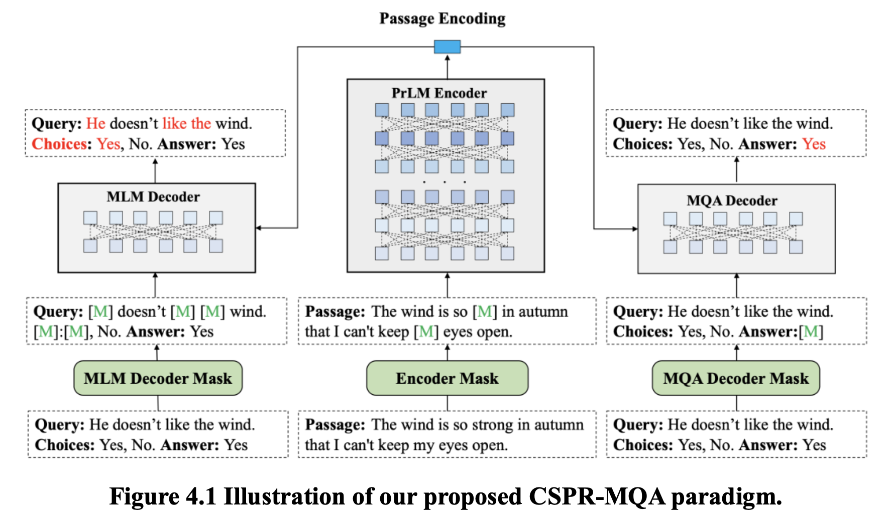
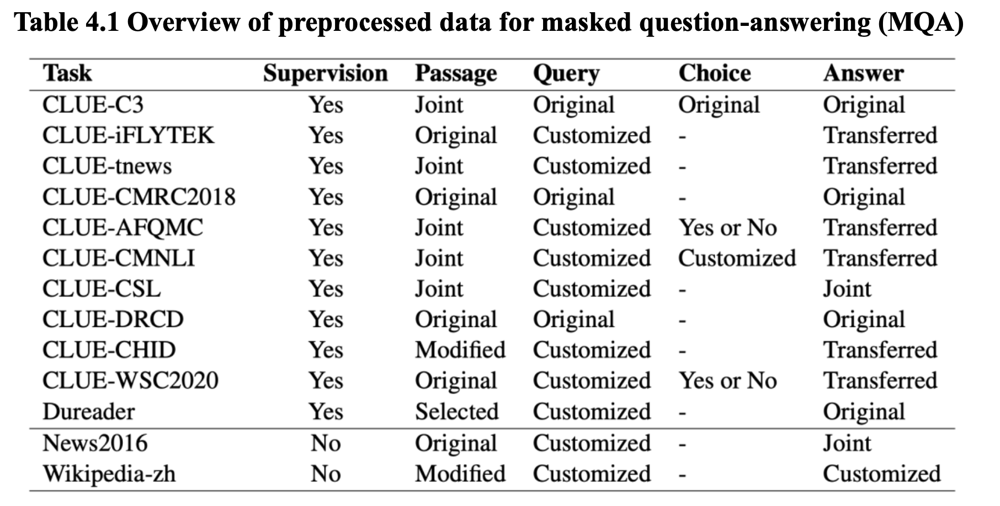
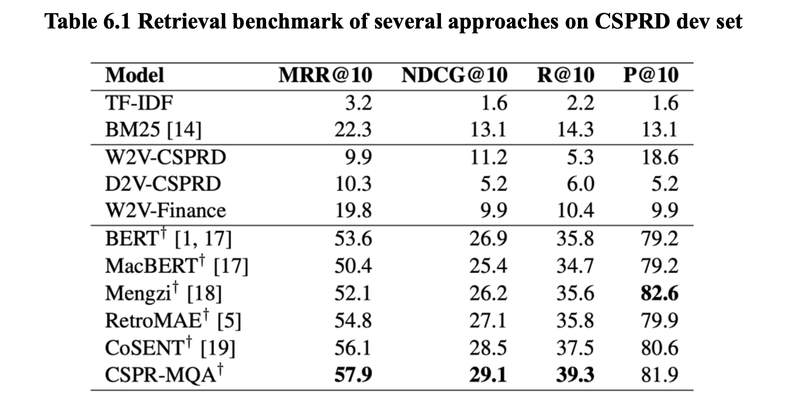

# The Chinese Stock Policy Retrieval Dataset (CSPRD)

This repo (under construction) contains the codebase and datasets for the paper: **CSPRD: A Financial Policy Retrieval Dataset for Chinese Stock Market.**

> 💻**Updated on 2024-03-07**: Our research code is now available.
>
> ❗️**Updated on 2023-09-11**: Our research paper is available on [arXiv](https://arxiv.org/abs/2309.04389).

The Policy Retrieval task is a new task that aims to retrieve relevant policy documents from a large corpus given a query. The CSPRD dataset is a new dataset for this task, which contains 700+ prospectus passages labeled by experienced experts with relevant articles from 10k+ entries in our collected Chinese policy corpus.



## 0. Repository Structure

- `csprd_dataset/`: contains the CSPRD dataset in Chinese and English
- `data/`: contains the processed HuggingFace dataset for training and evaluation
- `src/`: contains the source code for the experiments in the paper.
- `tasks/`: contains the code for different tasks on the CSPRD dataset, including:
      - `embedding_models`: the embedding models as baselines for the CSPRD dataset
      - `gen_dataset`: the code for generating the HuggingFace dataset for training and evaluation
      - `inference`: the code for inference on the CSPRD dataset
      - `lexical_models`: the lexical models as baselines for the CSPRD dataset
      - `pretrain`: the code for pretraining the models on the CSPRD dataset
      - `retrieval`: the code for retrieval on the CSPRD dataset


## 1. Abstract

In recent years, great advances in pre-trained language models (PLMs) have sparked considerable research focus and achieved promising performance on the approach of dense passage retrieval, which aims at retrieving relative passages from massive corpus with given questions. However, most of existing datasets mainly benchmark the models with factoid queries of general commonsense, while specialised fields such as finance and economics remain unexplored due to the deficiency of large-scale and high-quality datasets with expert annotations. 

In this work, we propose a new task, policy retrieval, by introducing the Chinese Stock Policy Retrieval Dataset (CSPRD), which provides 700+ prospectus passages labeled by experienced experts with relevant articles from 10k+ entries in our collected Chinese policy corpus. Experiments on lexical, embedding and fine-tuned bi-encoder models show the effectiveness of our proposed CSPRD yet also suggests ample potential for improvement. Our best performing baseline achieves 56.1% MRR@10, 28.5% NDCG@10, 37.5% Recall@10 and 80.6% Precision@10 on dev set.

To leverage high quality encodings, we proposed CSPR-MQA, a novel retrieval oriented pre-training paradigm, which unifies multiple forms of supervised NLP tasks into unsupervised form for masked question-answering (MQA). Our proposed CSPR-MQA achieves the best performance (57.9% MRR@10, 29.1% NDCG@10, 39.3% Recall@10 and 81.9% Precision@10) on the CSPRD dev set after pre-training on 61GB Chinese corpus and fine-tuning on CSPRD.

> 在近些年，预训练语言模型 (PLMs) 取得了巨大的进展，引发了大量的研究焦点，并在密集段落检索的方法上取得了令人瞩目的性能。此方法旨在根据给定的问题从大型文献中检索相关段落。然而，大多数现有的数据集主要是用一般常识的事实性查询来评估模型的性能，而像金融和经济这样的专业领域由于缺乏大规模、高质量且带有专家注解的数据集而尚未被探索。
> 
> 在这项工作中，我们提出了一个新任务，即政策检索。我们推出了“中国股票政策检索数据集”(CSPRD)，其中提供了700多个由经验丰富的专家标注的招股说明书段落，这些段落与我们收集的中国政策文献中的10k+条目中的相关文章有关。对词汇、嵌入和微调的双编码器模型的实验显示了我们提出的CSPRD的有效性，但也表明还有很大的改进潜力。在开发集上，我们表现最好的基线达到了56.1%的MRR@10，28.5%的NDCG@10，37.5%的Recall@10和80.6%的Precision@10。
> 
> 为了产生高质量编码，本研究提出了 CSPR-MQA，这是一种新颖的面向检索的预训练范例，它将多种形式的监督自然语 言处理任务统一为无监督形式，用于屏蔽问答(Masked Question Answering, MQA)。对词汇、嵌入和微调的双编码器模型进行的实验显示了本文提出的 CSPRD 的有效性，但也表明有很大的提升潜力。经过在 61GB 的中文语料上的预训练和在 CSPRD 上的微调，本文提出的 CSPR-MQA 预训练语言模型在 CSPRD 的开发集上达到了最先进的水平，获得 57.9% 的 MRR@10，29.1% 的 NDCG@10，39.3% 的 Recall@10 和 81.9% 的 Precision@10。


## 2. CSPRD Dataset

The CSPRD dataset contains 700+ prospectus passages labeled by experienced experts with relevant articles from 10k+ entries in our collected Chinese policy corpus. The dataset is released in both Chinese and English.

- Chinese version released in `csprd_dataset/csprd_zh` folder
- English version released in `csprd_dataset/csprd_en` folder

The annotation of the dataset is shown as follows:




## 3. CSPR-MQA Model

In this section, we introduce an aggressive method of masked language modeling (MLM) namely masked question answering (MQA), which is designed to be a rigorous reconstruction task to further enhance encoding quality. Inspired by [RetroMAE](https://github.com/staoxiao/RetroMAE), we propose CSPR-MQA, a novel retrieval oriented pre-training paradigm with asymmetric dual-decoder structure and asymmetric masking strategy. CSPR-MQA adopts a full-scale PrLM as its encoder and two identical one-layer transformer as its dual-decoder, namely MLM decoder and MQA decoder. 




## 4. Experiments

To reproduce the experiments in the paper, you can follow the steps below.

### 4.1. HF dataset Generation

First, we need to generate the HuggingFace dataset for training and evaluation. The code is in `tasks/gen_dataset/cspd` folder.

To generate the dataset, run the following command:
```bash
bash run_gen_dataset.sh
```


[`Optional`] If you want to pretain a new model with self-collected data, you can use the code in `tasks/gen_dataset/pretrain_corpus_chinese` folder. However, this step is optional, as you can directly use any existing pretrained models (BERT, RetroMAE, .etc) in the step 3. 

The corpus is collected from the following sources:




### 4.2. Pretraining on the CSPRD dataset (Optional)

Step 2, we pretrain the models on publicly available text corpus (need to be preprocessed first). The code is in `tasks/pretrain/masked_qa` folder.

To pretrain the models, run the following command:
```bash
cd tasks/pretrain/masked_qa
bash train_zh.sh
```

This step is optional, as you can directly use any existing pretrained models (BERT, RetroMAE, .etc) in the next step.

### 4.3. Fine-tuning on the CSPRD dataset

Step 3, we fine-tune the models on the CSPRD dataset. The code is in `tasks/retrieval/masked_qa` folder.

To fine-tune the models, run the following command:
```bash
cd tasks/retrieval/masked_qa
bash cspd_train.sh
```

### 4.4. Inference on the models

Step 4, we perform inference on the models on the CSPRD dataset. The code is in `tasks/inference/masked_qa` folder.

To perform inference, run the following command:
```bash
bash run_inference.sh
```

To run inference on embedding models, run the following command:
```bash
cd tasks/embedding_models
bash run_bert.sh
bash run_doc2vec.sh
bash run_t5.sh
bash run_trained_word2vec.sh
bash run_word2vec.sh
```

To run inference on lexical models, run the following command:
```bash
cd tasks/lexical_models
bash run_bm25.sh
bash run_tfidf.sh
bash run_word2vec.sh
```

## 5. Evaluation

We evaluate the models on the CSPRD dataset using the following metrics:
- MRR@10
- NDCG@10
- Recall@10
- Precision@10

The code for evaluation is in `tasks/retrieval/test.py` file. The script is included in the `run_all_in_one.sh` script, which includes all the steps from dataset generation to evaluation.

The evaluation results are shown as follows:




## Citation

If you find this dataset and paper useful or use the codebase in your work, please cite our paper:

```bibtex
@misc{wang2023csprd,
      title={CSPRD: A Financial Policy Retrieval Dataset for Chinese Stock Market}, 
      author={Jinyuan Wang and Hai Zhao and Zhong Wang and Zeyang Zhu and Jinhao Xie and Yong Yu and Yongjian Fei and Yue Huang and Dawei Cheng},
      year={2023},
      eprint={2309.04389},
      archivePrefix={arXiv},
      primaryClass={cs.CL}
}
```
